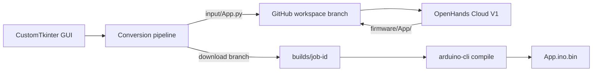

# Py2Cardputer

Py2Cardputer converts M5Stack **UIFlow 2.0 MicroPython** applications into native
**Arduino C++ firmware** for the **M5Stack Cardputer ADV**.

It is a Windows 11 desktop application built with Python and CustomTkinter. The
AI conversion runs in **OpenHands Cloud** against a branch of your permanent
GitHub workspace repository. Compilation runs locally with **Arduino CLI**.

> Py2Cardputer prepares and compiles firmware. It does not flash hardware, and a
> successful compile does not prove that the firmware behaves correctly on a
> device. Always review `CONVERSION_REPORT.md` and test the result yourself.

---

## What it does



For every conversion Py2Cardputer:

1. Validates the selected `.py` file without executing it.
2. Checks local Git authentication for the workspace repository.
3. Clones the repository once into `workspace/` and reuses that cache.
4. Creates a unique branch such as
   `py2cardputer/20261121-150000-myapp`.
5. Uploads the original source to `input/` and pushes the branch.
6. Starts an OpenHands Cloud V1 conversation bound to that repository and branch.
7. Polls the start task and then the conversation until it finishes.
8. Fetches `firmware/AppName/` from the branch.
9. Validates the Arduino sketch structure.
10. Compiles it locally with Arduino CLI.
11. Reports the `.bin` path and keeps the branch, source, logs and binary.

Branches, files and repositories are **never deleted or merged** by
Py2Cardputer. Cleanup is manual.

---

## Requirements

| Component | Notes |
| --- | --- |
| Windows 11 | PowerShell 7 or Windows PowerShell 5.1 |
| Python 3.11+ | 3.12 or 3.13 recommended |
| Git for Windows | Includes Git Credential Manager |
| Arduino CLI | Installed through winget or the official archive |
| M5Stack Arduino core | Provides the Cardputer board definition |
| M5Cardputer, M5Unified, M5GFX | Arduino libraries used by generated firmware |
| OpenHands Cloud account | API key and GitHub access to the workspace repository |
| Private GitHub repository | Default: `ITDUDE207/Py2Cardputer-Workspace` |

The workspace repository is configurable. If it is brand new, empty, or only
contains earlier conversion branches (no `main`/`master`), Py2Cardputer creates
a fresh **orphan branch** so a conversion never inherits another conversion's
files. It never writes to `main`.

---

## Install on Windows 11

### 1. Install Python, Git and Arduino CLI

```powershell
winget install --id Python.Python.3.12 -e
winget install --id Git.Git -e
winget install --id ArduinoSA.CLI -e
```

Close and reopen PowerShell so `python`, `git` and `arduino-cli` are on `PATH`.

### 2. Create the virtual environment

```powershell
cd C:\path\to\Py2Cardputer
py -3.12 -m venv .venv
Set-ExecutionPolicy -Scope CurrentUser RemoteSigned   # once, if activation is blocked
.\.venv\Scripts\Activate.ps1
python -m pip install --upgrade pip
pip install -r requirements.txt
```

### 3. Configure Git authentication

Py2Cardputer uses your existing local Git credentials. It never asks for a
password and never stores a token.

```powershell
git config --global user.name  "Your Name"
git config --global user.email "you@example.com"
git credential-manager github login
```

`gh auth login` also works if GitHub CLI is installed. Verify access to the
workspace repository before starting a conversion:

```powershell
git ls-remote https://github.com/ITDUDE207/Py2Cardputer-Workspace.git
```

A `Repository not found` or authentication error means OpenHands, Git and the
GUI will also fail. Fix it here first.

### 4. Install the M5Stack board core and libraries

```powershell
arduino-cli config init
arduino-cli config add board_manager.additional_urls https://static-cdn.m5stack.com/resource/arduino/package_m5stack_index.json
arduino-cli core update-index
arduino-cli core install m5stack:esp32
arduino-cli lib install "M5Cardputer"
arduino-cli lib install "M5Unified"
arduino-cli lib install "M5GFX"
```

Confirm the board identifier on your installation:

```powershell
arduino-cli board listall | Select-String -Pattern Cardputer
```

The default FQBN is `m5stack:esp32:m5stack_cardputer`. If your installation
lists a different Cardputer ADV identifier, change **Settings -> Arduino FQBN**
in the app. Do not assume the default is valid on every Arduino CLI install.

### 5. Configure Py2Cardputer

```powershell
Copy-Item .env.example .env
notepad .env
```

Set at least:

```dotenv
OPENHANDS_API_KEY=your-key
OPENHANDS_API_URL=https://app.all-hands.dev
PY2CARDPUTER_GITHUB_REPOSITORY=ITDUDE207/Py2Cardputer-Workspace
ARDUINO_CLI_PATH=arduino-cli
ARDUINO_FQBN=m5stack:esp32:m5stack_cardputer
```

Create an API key at <https://app.all-hands.dev/settings/api-keys>.

In OpenHands Cloud, connect GitHub under **Settings -> Integrations** and make
sure the workspace repository is accessible to the OpenHands installation.
Without that access, the conversation starts but cannot read the branch.

`.env` is git-ignored. The API key is never written to `config.json`, logs or the
GUI. The Settings page writes it only to `.env`.

### 6. Run

```powershell
python main.py
```

---

## Using the application

### Dashboard

Shows OpenHands, GitHub and Arduino CLI status, plus the most recent build and
its binary path. Use **Refresh status** after changing credentials or tooling.

### New Conversion

1. Click **Upload Python File** and choose a UIFlow 2.0 `.py` file.
2. Review the detected application name, hash and imports.
3. Pick the board profile (the FQBN is editable in Settings).
4. Click **Start Conversion**.
5. Follow the live step list, OpenHands task/conversation IDs, branch and
   compiler output.
6. On success, open the `.bin` from the result card or the build folder.

The GUI stays responsive because all network, Git and compiler work runs on a
background thread; progress is delivered to Tk through a thread-safe queue.

### Build History

Every job keeps its own folder:

```text
builds/<job-id>/
    job.json                 # status, IDs, hashes, paths
    source/app.py            # snapshot of the original source
    firmware/App/            # downloaded generated firmware
    bin/App.ino.bin          # compiled binary
    compile.log              # full compiler stdout/stderr
logs/<job-id>.log            # application log for the job
```

Nothing is overwritten: a new job gets a timestamp plus random suffix. Old
builds remain until you delete them manually.

### Settings

| Setting | Stored in |
| --- | --- |
| OpenHands API key | `.env` only |
| OpenHands API URL | `config.json` |
| GitHub repository | `config.json` |
| Arduino CLI path | `config.json` |
| Arduino FQBN | `config.json` |
| Build directory | `config.json` |
| Poll interval, timeouts | `config.json` |

Environment variables override `config.json`. See `.env.example` for the full
list. The API key is the only value that is never persisted to JSON.

---

## Command line

```powershell
python main.py --check
python main.py --history
python main.py --cli --file .\myapp.py
python main.py --cli --file .\myapp.py --fqbn m5stack:esp32:m5stack_cardputer
```

Exit codes: `0` success, `1` failed conversion/check, `2` configuration error,
`130` cancelled with Ctrl+C.

`--check` prints the effective configuration (with the API key masked), validates
it, and tests OpenHands, GitHub and Arduino CLI. It is the fastest way to
diagnose a broken setup.

---

## Configuration reference

Defaults live in `config.json`:

```json
{
  "openhands_api_url": "https://app.all-hands.dev",
  "github_repository": "ITDUDE207/Py2Cardputer-Workspace",
  "arduino_cli_path": "arduino-cli",
  "arduino_fqbn": "m5stack:esp32:m5stack_cardputer",
  "build_dir": "builds",
  "log_dir": "logs",
  "workspace_dir": "workspace",
  "poll_interval_seconds": 5.0,
  "startup_timeout_seconds": 900.0,
  "execution_timeout_seconds": 5400.0,
  "request_timeout_seconds": 60.0,
  "compile_timeout_seconds": 900.0,
  "keep_workspace_clone": true
}
```

Environment overrides:

| Variable | Purpose |
| --- | --- |
| `OPENHANDS_API_KEY` | API key (required) |
| `OPENHANDS_API_URL` | API base URL |
| `OPENHANDS_LLM_MODEL` | Optional model override |
| `PY2CARDPUTER_GITHUB_REPOSITORY` | Workspace repository (`owner/repo`) |
| `ARDUINO_CLI_PATH` | Arduino CLI executable |
| `ARDUINO_FQBN` | Target board |
| `PY2CARDPUTER_BUILD_DIR` | Build root |
| `PY2CARDPUTER_LOG_DIR` | Log root |
| `PY2CARDPUTER_WORKSPACE_DIR` | Git clone cache |
| `PY2CARDPUTER_POLL_INTERVAL` | Status poll seconds |
| `PY2CARDPUTER_STARTUP_TIMEOUT` | Seconds to wait for sandbox startup |
| `PY2CARDPUTER_EXECUTION_TIMEOUT` | Seconds to wait for the agent |
| `PY2CARDPUTER_REQUEST_TIMEOUT` | HTTP request timeout |

---

## OpenHands integration

Py2Cardputer implements the OpenHands Cloud **V1** API documented at
<https://docs.openhands.dev/openhands/usage/cloud>:

| Operation | Request |
| --- | --- |
| Start conversion | `POST /api/v1/app-conversations` with `initial_message`, `selected_repository`, `selected_branch`, `git_provider` |
| Poll startup | `GET /api/v1/app-conversations/start-tasks?ids=<id>` |
| Poll execution | `GET /api/v1/app-conversations?ids=<id>` |
| Search conversations | `GET /api/v1/app-conversations/search` |

The client stores the start task ID, conversation ID and conversation URL on the
job so you can reopen the OpenHands conversation later. Authentication uses
`Authorization: Bearer <OPENHANDS_API_KEY>`; the key is redacted from logs and
error messages.

Timeouts, HTTP 401/403, HTTP 4xx validation errors, HTTP 5xx responses and
network failures are handled explicitly. Transient `GET` failures are retried
with backoff; `POST` is never retried to avoid duplicate conversations.

---

## Generated firmware

OpenHands is instructed to produce:

```text
firmware/AppName/AppName.ino
firmware/AppName/README.md
firmware/AppName/CONVERSION_REPORT.md
```

Additional `.h`/`.cpp` files are allowed. The prompt requires the agent to:

- analyse the whole Python source and its imports;
- preserve behaviour where possible;
- use the official M5Cardputer library, M5Unified and M5GFX;
- implement keyboard, display, callbacks, UI and animations without placeholders;
- avoid invented hardware APIs and document unsupported features;
- commit to the conversion branch and never merge into `main`;
- never claim the firmware was compiled or tested on hardware.

Before compiling, Py2Cardputer checks that the sketch folder matches the `.ino`
name, that `setup()` and `loop()` exist, that the file is not empty, and that the
M5 libraries are included. Missing companion documents and placeholder markers
produce warnings rather than hard failures.

### Flashing with M5Launcher

The compiler output directory contains `AppName.ino.bin`. Copy that file to the
Cardputer SD card and install it with M5Launcher, following M5Stack's current
M5Launcher instructions. If your Cardputer ADV requires a different board
definition or partition layout, adjust the FQBN in Settings before compiling.

---

## Project structure

```text
Py2Cardputer/
    main.py                     # GUI / CLI entry point
    config.json                 # non-secret settings
    requirements.txt
    requirements-dev.txt
    .env.example
    .gitignore
    README.md

    ui/
        app.py                  # window, sidebar, threading, job wiring
        dashboard.py            # system status and last build
        conversion.py           # upload, live progress, compiler terminal
        history.py              # previous builds and artifacts
        settings.py             # editable configuration
        about.py                # workflow, guarantees, documentation links
        theme.py                # colors, fonts, widget options
        widgets.py              # shared cards, step list, terminal

    ai/
        openhands_client.py     # OpenHands Cloud V1 client
        conversion_prompt.py    # conversion instructions
        task_monitor.py         # startup + execution polling

    github/
        repository.py           # clone, auth, commit/push, archive download
        branches.py             # branch naming and validation
        downloader.py           # firmware download facade

    compiler/
        arduino_cli.py          # detection, version, compile, binary lookup
        validator.py            # generated sketch validation

    core/
        config.py               # config.json + .env loading and saving
        logger.py               # redaction and job log files
        models.py               # job, steps, results, progress events
        validation.py           # source validation and app naming
        jobs.py                 # persistent job store
        pipeline.py             # end-to-end conversion pipeline
        errors.py               # typed errors

    builds/                     # per-job artifacts (git-ignored)
    logs/                       # application logs (git-ignored)
    workspace/                  # git clone cache (git-ignored)
    tests/
```

---

## Security and reliability

- The API key comes from `.env` or the process environment only. It is never
  written to `config.json`, logs, build metadata or GUI output.
- Logs pass through a redacting filter that also catches bearer headers and
  common token formats.
- Uploaded Python is read, hashed and parsed with `ast`; it is never executed.
- Filenames are sanitised before use in branches and paths.
- Archive extraction rejects path traversal outside the job folder.
- Git runs non-interactively; missing credentials fail fast instead of hanging.
- All long-running work runs off the Tk main thread.
- New jobs never overwrite existing build folders.
- Branches and files are never deleted automatically.
- Conversion files are never pushed to `main` by Py2Cardputer. The prompt also
  forbids the agent from merging or deleting.

---

## Testing

```powershell
pip install -r requirements-dev.txt
python -m pytest
```

The suite covers configuration, filename and branch sanitisation, source
validation, Arduino CLI detection/compilation, sketch validation, OpenHands
request/error handling, task monitoring, job persistence, prompt content, the
full pipeline with injected fakes, and a real-git round trip against a local
bare repository. No credentials are required.

---

## Verification status and limitations

Verified while building this version:

- 186 unit and integration tests pass without credentials.
- All modules compile and import.
- GitHub authentication and cloning against the configured workspace repository
  were exercised successfully.
- A repository with no `main`/`master` (empty, or only conversion branches) is
  detected and handled through a fresh orphan branch; this was verified
  end-to-end against local bare repositories, including a repository whose
  default branch was a previous conversion branch.
- A live OpenHands Cloud conversion was run against
  `ITDUDE207/Py2Cardputer-Workspace` on branch
  `py2cardputer/20261121-052503-demo`. `TaskMonitor` observed the start task
  reach `READY` and the conversation reach `finished`; `FirmwareDownloader`
  pulled commit `dab918d5`; `validate_sketch_tree` accepted
  `firmware/Demo/Demo.ino`, `README.md` and `CONVERSION_REPORT.md`.
- The generated sketch compiled locally with Arduino CLI 1.6.0,
  `m5stack:esp32@3.3.10`, `M5Cardputer@1.1.1`, `M5Unified@0.3.0` and
  `M5GFX@0.3.0`, producing a 550,656-byte `Demo.ino.bin` in this Linux
  container. This exercises the real `ArduinoCLI` module, not a fake.
- The OpenHands V1 endpoints respond with HTTP 401 to an invalid key, confirming
  the base URL and routes used by the client.

Not verified in the build environment:

- **Windows rendering and Windows toolchain**: the build container has no Tk
  libraries or display. UI modules are import-tested with stubbed Tk widgets;
  run `python main.py` on Windows 11 to verify the rendered interface and the
  Git Credential Manager / Arduino CLI behaviour there.
- **Complex UIFlow applications**: the live smoke test used a two-line demo
  (`from m5stack import *` / `print("hello")`), not a large app with Wi-Fi,
  sensors, timers and animations. Conversion quality for complex apps depends
  on the OpenHands agent and the generated `CONVERSION_REPORT.md`.
- **Hardware behaviour and flashing**: the binary was not flashed and the
  firmware was not run on a Cardputer. M5Launcher flashing is a manual step.
- **OpenHands live error paths**: authentication failures, rate limits, sandbox
  failures and timeouts are covered by unit tests with fakes, not by destructive
  live tests.
- The configured workspace repository was **initially empty and is public** at the time of
  writing. Its first pushed conversion branch became GitHub's default branch;
  Py2Cardputer now ignores conversion branches when choosing a base and creates
  a fresh orphan branch instead. Make the repository private manually if
  required; Py2Cardputer does not change repository visibility or the GitHub
  default branch.

---

## Troubleshooting

| Symptom | Fix |
| --- | --- |
| `OPENHANDS_API_KEY is not configured` | Copy `.env.example` to `.env`, add the key, restart or press Refresh |
| OpenHands 401/403 | Regenerate the API key; check `OPENHANDS_API_URL` has no `/api/v1` suffix |
| `Git could not authenticate` | Run `git credential-manager github login`, then `git ls-remote <repo>` |
| `Repository not found` | Confirm the repository name and that your GitHub account can read it |
| OpenHands starts but cannot see the branch | Grant the OpenHands GitHub app access to the workspace repository |
| `Arduino CLI was not found` | Install it, reopen PowerShell, or set the full path in Settings |
| `Platform 'm5stack:esp32' not found` | Add the M5Stack board manager URL and run `arduino-cli core install m5stack:esp32` |
| `Invalid FQBN` | Run `arduino-cli board listall`, find the Cardputer entry and copy its exact FQBN |
| Compile succeeds but no `.bin` | Check `compile.log`; adjust FQBN or partition options |
| `waiting_for_confirmation` | Open the conversation URL shown in the GUI and answer the agent |
| Conversion timed out | Increase the startup/execution timeouts in Settings |
| Branch left behind after a failure | Expected. Inspect it on GitHub and delete it manually when finished |
| `libtk8.6.so` / Tk error on Linux | Install Tk; Windows Python installers include it |

---

## Documentation links

- OpenHands Cloud: <https://docs.openhands.dev/openhands/usage/cloud>
- OpenHands API keys: <https://app.all-hands.dev/settings/api-keys>
- Arduino CLI: <https://arduino.github.io/arduino-cli/>
- M5Stack Arduino setup: <https://docs.m5stack.com/en/arduino/arduino_board>
- M5Cardputer library: <https://github.com/m5stack/M5Cardputer>
- M5Unified: <https://github.com/m5stack/M5Unified>
- M5GFX: <https://github.com/m5stack/M5GFX>

---

## License and status

Py2Cardputer V1 is a local developer tool. Review every generated sketch and
conversion report before flashing a device. Firmware quality depends on the
OpenHands agent and on the accuracy of the original UIFlow application.
